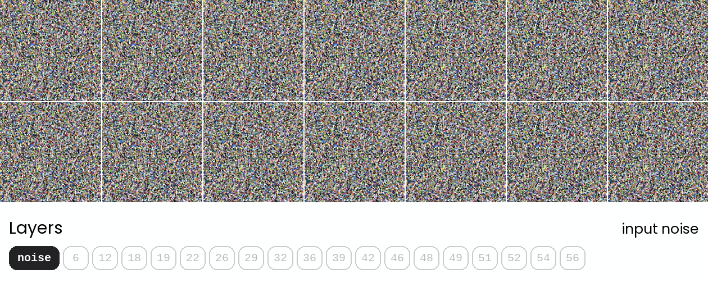
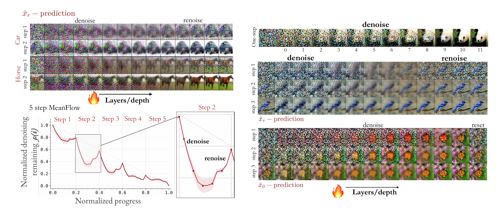

<div align="center">

# Depth As Time in One-Step Generative Models

Arnold Caleb Asiimwe · William Yang · Sanghyuk Chun · Esin Tureci · Olga Russakovsky

Princeton University

[](https://arxiv.org/abs/2610.03626)

</div>

**TL;DR:** One-step generative models compress the multi-step trajectory of diffusion into a single forward pass. We find that the denoising computation does not disappear. It reappears across network depth, and decoding intermediate layers with the model's own output head recovers a denoising-like trajectory. We call this **depth as time**. Its form depends on the transport task the model is trained to solve, and models that exhibit it can be compressed into a single time-conditioned block (e.g., a MeanFlow SiT-L/2 compressed 16.6× in parameters).

<p align="center">
  
</p>
<p align="center"><em>FLUX.1-schnell, one forward pass: decoding each layer with the model's own output head, from the input noise to the final image.</em></p>

## MeanFlow: denoise, then renoise

Flow maps such as MeanFlow are trained to transport a sample from noise level t to an endpoint r. When we ask a MeanFlow model for a noisy intermediate endpoint (0 < r < t) instead of the clean image, its layers first reveal a cleaner image and then add noise back toward the requested endpoint, all within a single network evaluation. The depthwise computation depends on the transport task the model is asked to solve.

<p align="center">
  
</p>

## Code
Code and checkpoints coming soon!

## Citation

If you find this work useful, please cite:

```bibtex
@misc{asiimwe2026depthtimeonestepgenerative,
      title={Depth as Time in One-Step Generative Models},
      author={Arnold Caleb Asiimwe and William Yang and Sanghyuk Chun and Esin Tureci and Olga Russakovsky},
      year={2026},
      eprint={2610.03626},
      archivePrefix={arXiv},
      primaryClass={cs.AI},
      url={https://arxiv.org/abs/2610.03626},
}
```
